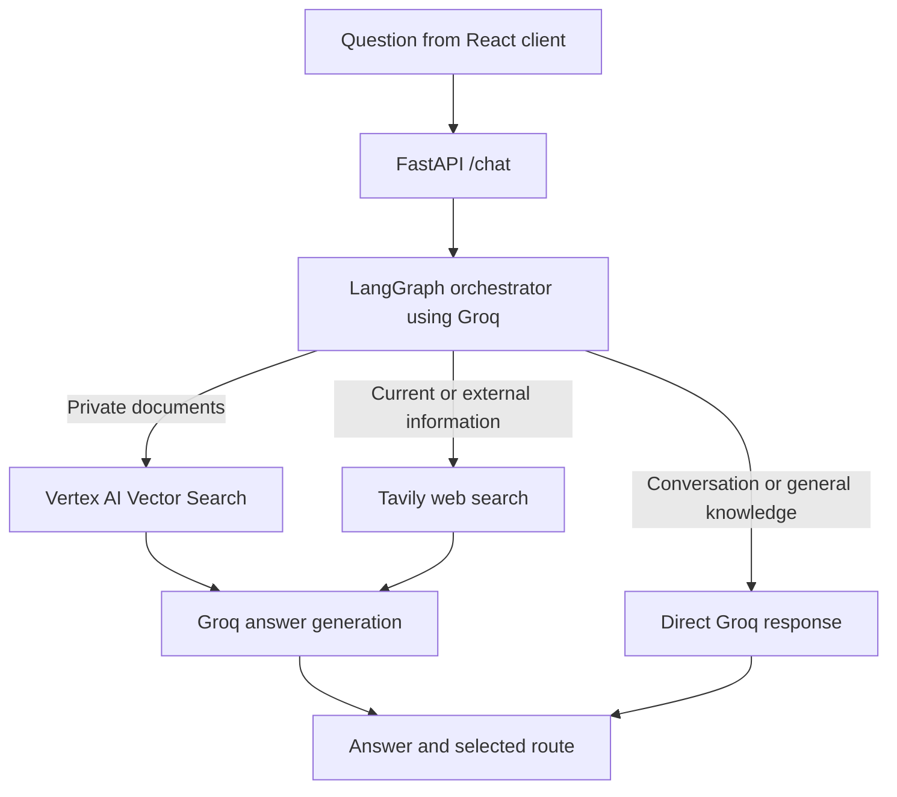

# Multi-Agent RAG

Multi-Agent RAG is a question-answering application that routes each question to the most suitable information source: a private document index, live web search, or the language model directly. When a question needs both private-document context and current web information, it retrieves from both and combines the results into one response.

The backend is built with FastAPI and LangGraph. Groq provides the chat model, Vertex AI provides text embeddings and Vector Search, and Tavily provides web search. The browser client is a React application built with Vite and hosted through Firebase Hosting.

## How It Works



For document questions, the application retrieves up to four relevant chunks from the vector index. Web search returns up to three results. The router may select `vector_db`, `web_search`, `both`, or `direct`.

## Repository Layout

```text
Backend/
	agent.py                 LangGraph workflow, routing, retrieval, and answer generation
	app.py                   FastAPI health and chat endpoints, CORS configuration
	ingest.py                Create a new Vertex AI Vector Search index and ingest PDFs
	ingest_existing.py       Ingest PDFs into an existing Vector Search index
	vector_store_ids.txt     Vertex AI index and endpoint identifiers used by the agent
	Dockerfile               Cloud Run container configuration
	requirements.txt         Pip dependency list
	pyproject.toml           Project metadata and dependencies for uv
	uv.lock                  Locked uv dependency resolution
	frontend/                React/Vite chat client and Firebase Hosting configuration
```

PDF files are not included in this repository. The ingestion scripts currently contain a machine-specific Windows PDF path. Before running either script on another machine, update its `PDF_PATHS` list to point to the local PDF file or files.

## Requirements

- Python 3.14 or newer for the local environment declared in `pyproject.toml`
- Node.js and npm for the frontend
- Google Cloud project with Vertex AI and Cloud Storage configured, a staging bucket, and permissions for Vertex AI Vector Search and embeddings
- Groq API key
- Tavily API key
- Application Default Credentials for local Google Cloud access; on Cloud Run, use a service account with the necessary permissions
- `uv` for the locked Python setup, or pip for the `requirements.txt` setup

The Dockerfile currently uses Python 3.12 and installs from `requirements.txt`; local Python metadata and container Python versions are not identical.

## Configuration

Create `Backend/.env` for local backend and ingestion runs. Do not commit this file or put API keys in frontend variables.

```dotenv
GROQ_API_KEY=your_groq_api_key
TAVILY_API_KEY=your_tavily_api_key
GCP_PROJECT_ID=your_google_cloud_project_id
GCP_REGION=us-central1
GCS_BUCKET=your_vertex_ai_staging_bucket

# Used by ingest.py when creating new resources
INDEX_DISPLAY_NAME=multi-agent-rag-index
ENDPOINT_DISPLAY_NAME=multi-agent-rag-endpoint
```

`agent.py` reads the index and endpoint identifiers from `vector_store_ids.txt`. That file must contain:

```text
INDEX_ID=your_vertex_ai_index_id
ENDPOINT_ID=your_vertex_ai_endpoint_id
```

`ingest.py` writes these identifiers after creating new resources. `ingest_existing.py` uses IDs defined in that script and does not write `vector_store_ids.txt`; update the file with the matching IDs before starting the application.

For local Google Cloud authentication, sign in with Application Default Credentials:

```powershell
gcloud auth application-default login
```

## Run Locally

### Backend

From the `Backend` directory, install dependencies with either `uv`:

```powershell
uv sync
uv run uvicorn app:app --reload --host 127.0.0.1 --port 8080
```

Or use pip in a Python 3.14+ virtual environment:

```powershell
py -3.14 -m venv .venv
.\.venv\Scripts\Activate.ps1
python -m pip install --upgrade pip
pip install -r requirements.txt
uvicorn app:app --reload --host 127.0.0.1 --port 8080
```

The graph and its external services are initialized when the backend starts. Configure the required keys, Google Cloud access, and vector-store IDs before running it. The API will be available at `http://127.0.0.1:8080`; interactive API documentation is at `http://127.0.0.1:8080/docs`.

### Frontend

In a second terminal, from `Backend/frontend`, create `.env.local` with the backend base URL:

```dotenv
VITE_API_URL=http://127.0.0.1:8080
```

Then install packages and start the Vite development server:

```powershell
npm ci
npm run dev
```

Open `http://localhost:5173`. The frontend sends requests to `POST ${VITE_API_URL}/chat`. Vite embeds `VITE_` variables in the browser bundle, so this variable must contain only the API URL, never a secret.

## Ingest PDF Documents

Choose the script that matches your Vector Search setup. Update the script's `PDF_PATHS` entry before running it.

- `ingest.py` creates a new Vector Search index and endpoint, deploys the index, ingests PDF chunks, and writes the created IDs to `vector_store_ids.txt`. Resource creation and deployment can take several minutes and may incur Google Cloud charges.
- `ingest_existing.py` connects to an existing index and endpoint and adds PDF chunks. Update `INDEX_ID` and `ENDPOINT_ID` in the script for your own resources, then update `vector_store_ids.txt` to those same IDs so the application can connect.

Run the selected script from the `Backend` directory after configuring `.env` and Google Cloud credentials:

```powershell
python ingest.py
```

Or, to use an existing index:

```powershell
python ingest_existing.py
```

The scripts clean extracted PDF text, split it into chunks of 1,000 characters with 150 characters of overlap, and create embeddings with Vertex AI's `text-embedding-005` model. Keep the same embedding model for ingestion and querying.

## API

### `GET /`

Returns a basic service health response.

### `POST /chat`

Request:

```json
{
	"question": "What happens in the story?"
}
```

Response:

```json
{
	"question": "What happens in the story?",
	"route": "vector_db",
	"answer": "..."
}
```

An empty or whitespace-only question returns HTTP 400. The `route` value indicates which source the orchestrator selected.

## Deployment

### Backend on Cloud Run

The Dockerfile starts Uvicorn on port 8080. From `Backend`, deploy the service with the Google Cloud CLI after configuring the project, runtime service account, and required environment variables/secrets:

```powershell
gcloud run deploy multi-agent-rag `
	--source . `
	--project YOUR_GCP_PROJECT `
	--region us-central1 `
	--service-account YOUR_CLOUD_RUN_SERVICE_ACCOUNT
```

Provide `GROQ_API_KEY` and `TAVILY_API_KEY` to Cloud Run through Secret Manager, not source code or image build arguments. Configure `GCP_PROJECT_ID`, `GCP_REGION`, `GCS_BUCKET`, and the vector-store IDs for the deployed service. The runtime service account needs access to the required Vertex AI and Cloud Storage resources. The current FastAPI app has no user authentication; CORS only controls browser origins and is not an API access-control mechanism.

### Frontend on Firebase Hosting

Set `VITE_API_URL` in `Backend/frontend/.env.local` to the deployed Cloud Run base URL, then build and deploy from `Backend/frontend`:

```powershell
npm ci
npm run build
firebase deploy --only hosting
```

Sign in to Firebase CLI and select the intended Firebase project before deploying. `firebase.json` serves the generated `dist` directory. Add the deployed frontend origin to the `allow_origins` list in `Backend/app.py` before deploying the backend if it is not already present; the current list includes the configured Firebase site and `http://localhost:5173`.

## Security Notes

- Never commit `.env`, `.env.local`, service-account key files, or API keys.
- Keep Google Cloud credentials outside the repository. Prefer Application Default Credentials locally and an attached service account on Cloud Run.
- Do not add private PDFs or other sensitive source documents to a public repository.
- Restrict CORS to trusted frontend origins, but do not treat CORS as authentication.
- Treat Google Cloud resource identifiers as configuration; they are not substitutes for credentials or IAM permissions.
